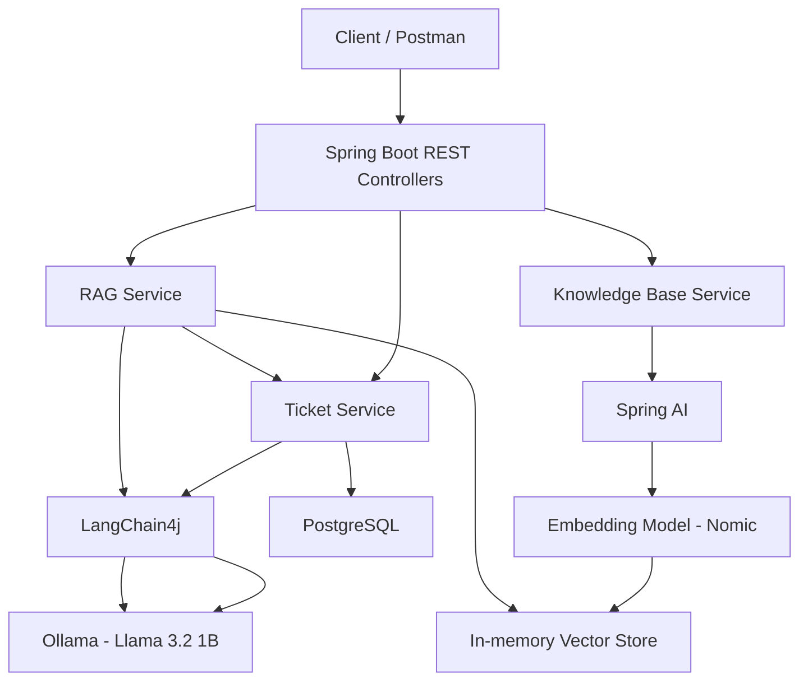
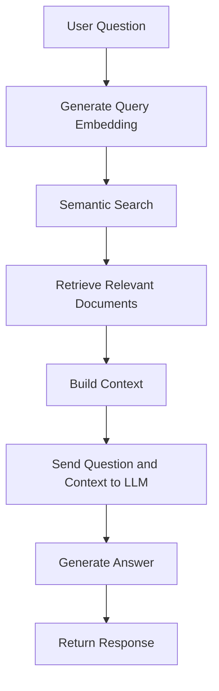

# AI-Powered-Support-Ticket-Assistant
# AI Support Assistant

An AI-powered customer support ticket management application built using **Java 21, Spring Boot, Spring AI, LangChain4j, Ollama, and PostgreSQL**.

The application helps support teams classify incoming tickets, retrieve relevant information from a knowledge base, generate suggested customer responses, and prioritize tickets based on both AI assessment and the actual impact on users.

## 1. Key Features

- **Ticket Management:** Create, retrieve, update, and delete support tickets through REST APIs.
- **AI Ticket Classification:** Automatically classify tickets into categories such as PAYMENT, AUTHENTICATION, TECHNICAL, ACCOUNT, and OTHER.
- **AI Priority Assessment:** Use an LLM to estimate ticket priority (LOW, MEDIUM, HIGH, CRITICAL).
- **Knowledge Base Search:** Retrieve relevant support documentation using semantic similarity search.
- **RAG-based Response Generation:** Generate customer-facing responses using retrieved knowledge base documents as context.
- **Impact-based Priority Adjustment:** Allow support teams to assess how many users are affected and recalculate the final ticket priority.
- **Data Persistence:** Store tickets and AI-generated information in PostgreSQL.
- **Input Validation and Exception Handling:** Validate API requests and handle application errors.

## 2. Technology Stack

| Technology | Purpose |
|---|---|
| Java 21 | Programming language |
| Spring Boot 4.0.9 | Application framework |
| Spring AI 2.0.2 | Embeddings and vector search |
| LangChain4j 1.22.0 | LLM integration and prompt-based classification |
| Ollama | Local LLM execution |
| Llama 3.2 1B | Ticket classification and response generation |
| Nomic Embed Text | Text embeddings |
| PostgreSQL | Relational database |
| Maven | Build and dependency management |
| REST APIs | Application communication |

## 3. Architecture

The application uses two AI integration libraries for different responsibilities:

- **LangChain4j:** Handles ticket classification and LLM interactions.
- **Spring AI:** Handles document embeddings and semantic retrieval from the knowledge base.

### High-level architecture



### Ticket creation workflow

1. A support ticket is submitted through the REST API.
2. The application sends the ticket title and description to the LLM.
3. The LLM predicts the ticket category and initial priority.
4. A basic payment-related classification guardrail is applied.
5. The RAG service searches the knowledge base for relevant documentation.
6. Retrieved documentation is passed to the LLM as context.
7. The LLM generates a suggested customer response.
8. The ticket and its AI-generated information are saved in PostgreSQL.

### RAG workflow



## 4. Impact-based Priority Assessment

The application separates the AI-predicted priority from the final priority determined after human impact assessment.

A support agent can specify how many users are affected:

- FEW
- MEDIUM
- MOST
- ALL

The application calculates the final priority using the higher of the AI priority and the impact priority.

### Priority mapping

| Affected user scope | Impact priority |
|---|---|
| FEW | LOW |
| MEDIUM | MEDIUM |
| MOST | HIGH |
| ALL | CRITICAL |

**Final Priority = MAX(AI Priority, Impact Priority)**

For example:

| AI Priority | User Impact | Final Priority |
|---|---|---|
| LOW | FEW | LOW |
| MEDIUM | FEW | MEDIUM |
| MEDIUM | ALL | CRITICAL |
| HIGH | MOST | HIGH |
| CRITICAL | FEW | CRITICAL |

This approach ensures that an issue affecting all users is escalated even if the initial AI assessment considers it low priority.

## 5. REST API Documentation

Base URL: `http://localhost:8080`

### Ticket APIs

| Method | Endpoint | Description |
|---|---|---|
| POST | `/api/tickets` | Create a ticket with AI classification and suggested response |
| GET | `/api/tickets` | Retrieve all tickets |
| GET | `/api/tickets/{id}` | Retrieve a ticket by ID |
| PUT | `/api/tickets/{id}` | Update ticket details |
| DELETE | `/api/tickets/{id}` | Delete a ticket |
| PUT | `/api/tickets/{id}/impact` | Assess impact and recalculate priority |

### Knowledge Base APIs

| Method | Endpoint | Description |
|---|---|---|
| GET | `/api/knowledge/search?query={query}` | Search relevant knowledge base documents |
| GET | `/api/knowledge/ask?question={question}` | Generate an answer using RAG |

## 6. Sample API Requests

### Create a support ticket

**POST** `/api/tickets`

Request:

```json
{
  "title": "Payment deducted but order not placed",
  "description": "The amount was deducted from my bank account but the order is not showing in my order history. Please help me resolve this issue."
}
```

The response includes:

- Ticket ID
- AI-predicted category
- AI-predicted priority
- Final priority
- Ticket status
- AI-generated suggested response
- Creation timestamp

### Assess ticket impact

**PUT** `/api/tickets/10/impact`

Request:

```json
{
  "affectedUserScope": "ALL"
}
```

The application recalculates the final priority while retaining the original AI priority.

### Search the knowledge base

**GET**

`/api/knowledge/search?query=Payment%20deducted%20but%20order%20not%20placed`

Returns the most relevant knowledge base documents based on semantic similarity.

### Ask a question using RAG

**GET**

`/api/knowledge/ask?question=Payment%20deducted%20but%20order%20not%20placed`

Retrieves relevant support documentation and uses it as context for generating an answer.

## 7. Project Setup

### Prerequisites

- Java 21
- Maven
- PostgreSQL
- Ollama

### Step 1: Install Ollama models

Install and run Ollama, then pull the required models:

```bash
ollama pull llama3.2:1b
ollama pull nomic-embed-text
```

Ensure Ollama is running at:

`http://localhost:11434`

### Step 2: Create PostgreSQL database

```sql
CREATE DATABASE ai_support_db;
```

### Step 3: Configure application properties

Update `src/main/resources/application.properties`:

```properties
spring.application.name=ai-support-assistant

server.port=8080

spring.datasource.url=jdbc:postgresql://localhost:5432/ai_support_db
spring.datasource.username=postgres
spring.datasource.password=YOUR_PASSWORD

spring.jpa.hibernate.ddl-auto=update
spring.jpa.show-sql=true
spring.jpa.properties.hibernate.format_sql=true

spring.ai.ollama.base-url=http://localhost:11434
spring.ai.ollama.embedding.options.model=nomic-embed-text
```

### Step 4: Run the application

Using Maven:

```bash
mvn spring-boot:run
```

Or run `AiSupportAssistantApplication.java` directly from Spring Tool Suite.

The application will start at:

`http://localhost:8080`

## 8. End-to-End Testing

The following core scenarios were tested using Postman.

| Test | Scenario | Expected Result |
|---|---|---|
| 1 | Create a payment support ticket | Ticket created with AI classification and suggested response |
| 2 | Retrieve the created ticket | Ticket details retrieved successfully |
| 3 | Search the knowledge base | Relevant payment documentation retrieved |
| 4 | Generate an answer using RAG | Response generated using retrieved documentation |
| 5 | Set affected user scope to ALL | Final priority becomes CRITICAL |
| 6 | Retrieve ticket after impact assessment | Original AI priority and updated final priority persisted |
| 7 | Change affected user scope to FEW | Final priority recalculated to MEDIUM |

All seven core test scenarios passed.

## 9. Current Implementation Notes

- Ollama models run locally, avoiding the need for an external LLM API.
- The vector store is currently in-memory. Documents and embeddings are loaded again when the application starts.
- The knowledge base contains sample support documentation.
- Ticket classification includes a basic payment-related rule as a guardrail.
- AI-generated responses may vary depending on model output.
- The project is a learning and demonstration application, not a production-ready support platform.

## 10. Future Enhancements

- Integrate a persistent vector database such as PostgreSQL with pgvector.
- Add authentication and role-based access control.
- Introduce a frontend dashboard for support agents.
- Add ticket assignment and escalation workflows.
- Improve classification through structured LLM output and additional validation.
- Add automated tests for services, controllers, and AI integration.
- Add Docker-based deployment.

---

**Project:** AI Support Assistant  
**Domain:** AI-powered Customer Support Automation  
**Primary Focus:** Java Backend Development, Spring Boot, LLM Integration, Semantic Search, and Retrieval-Augmented Generation (RAG).
